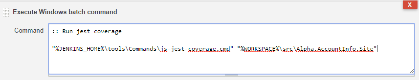
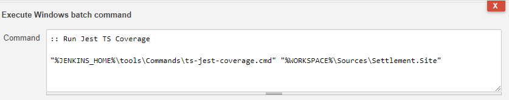
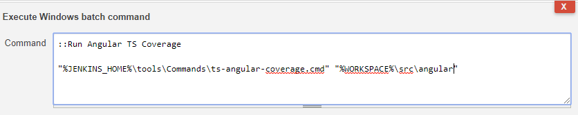

*************************************************************
Import Code Coverage For JavaScript & TypeScript
*************************************************************

We will config **a Jenkins job** to follow the below steps:

* Run test, generate unit test result and coverage report (lcov type).
* Import unit test and coverage report to SonarQube server.

JavaScript
##########

1. Run test & generate report:
******************************

a. For projects using **jest**:

* **In your project**: install the package **jest-sonar-reporter**:

::

	npm i -D jest-sonar-reporter

Configure Jest in your **package.json** to use jest-sonar-reporter as a custom results processor:

::

	{
	  "jest": {
		"testResultsProcessor": "jest-sonar-reporter"
	  }
	}

* **In Jenkins Job**: add an **Execute Windows batch command** build step behind the step **Build a Visual Studio project or solution using MSBuild** in the Build section as below:

::

"%JENKINS_HOME%\tools\Commands\js-jest-coverage.cmd" "%WORKSPACE%\src\Alpha.AccountInfo.Site"

	with: 
		* *"%WORKSPACE%\\src\\Alpha.AccountInfo.Site"*: the root test folder contains **package.json** config. You need to input the corresponding test folder in your project.
	
	This command will run test, generate unit test result and coverage report (lcov).

b. **For other frameworks and test runners**:

	You can ask NexOps for help.

2. Import report:
*****************

* In the step **SonarQube Scanner for MSBuild - Begin Analysis**, add additional arguments:

::

/d:sonar.javascript.lcov.reportPaths="${WORKSPACE}\js-lcov\lcov.info"
/d:sonar.testExecutionReportPaths="${WORKSPACE}\js-test-report.xml"
/d:sonar.tests=tests
/d:sonar.test.inclusions=**/*.test.jsx

with:
	* **/d:sonar.javascript.lcov.reportPaths**: the coverage report paths.
	* **/d:sonar.testExecutionReportPaths**: the unit test result paths.
	* **/d:sonar.tests**: the root folder paths contain test files. You must input the corresponding test folders in your projects.
	* **/d:sonar.test.inclusions**: the inclusion patterns for test files. You maybe change if needed.
	
.. note::
	
	* These arguments can contain multi values separated by comma.
	
	* You shall not need to change these two arguments **/d:sonar.javascript.lcov.reportPaths** and **/d:sonar.testExecutionReportPaths** unless you run jest by your own statement.
	
	* For source codes not included in project files .csproj, we need to configure source folders as below:
	
		**/d:sonar.sources=src1,src2**
	
		SonarQube Scanner will scan additional source codes in these folders and import them to server.
		
		
TypeScript
##########

1. Run test & generate report:
******************************

a. For projects using **jest**:

* **In your project**: install the package **jest-sonar-reporter**:

::

	npm i -D jest-sonar-reporter

Configure Jest in your **package.json** to use jest-sonar-reporter as a custom results processor:

::

	{
	  "jest": {
		"testResultsProcessor": "jest-sonar-reporter"
	  }
	}

* **In Jenkins Job**: add an **Execute Windows batch command** build step behind the step **Build a Visual Studio project or solution using MSBuild** in the Build section as below:

::

"%JENKINS_HOME%\tools\Commands\ts-jest-coverage.cmd" "%WORKSPACE%\Sources\Settlement.Site"

	with: 
		* *"%WORKSPACE%\\Sources\\Settlement.Site"*: the root test folder contains **package.json** config. You need to input the corresponding test folder in your project.
	
	This command will run test, generate unit test result and coverage report (lcov).

b. For projects using **angular \+ karma**:

* **In your project**: install the packages **karma-coverage-istanbul-reporter** and **karma-sonarqube-unit-reporter**:

::

	npm i karma-coverage-istanbul-reporter karma-sonarqube-unit-reporter -D

And add the following config in **karma.conf.js**:

::

	plugins: [
	   ...,
	   require('karma-coverage-istanbul-reporter'),
	   require('karma-sonarqube-unit-reporter')
	],
	coverageIstanbulReporter: {
	   dir: require('path').join(__dirname, 'reports/coverage'),
	   reports: ['lcov'],
	   fixWebpackSourcePaths: true
	},
	sonarQubeUnitReporter: {
	   sonarQubeVersion: 'LATEST',
	   outputFile: 'reports/ts-test-report.xml',
	   useBrowserName: false
	},
	reporters: ['progress', 'coverage-istanbul', 'sonarqubeUnit'],

* **In Jenkins Job**: add an **Execute Windows batch command** build step behind the step **Build a Visual Studio project or solution using MSBuild** in the Build section as below:

::

"%JENKINS_HOME%\tools\Commands\ts-angular-coverage.cmd" "%WORKSPACE%\src\angular"

	with: 
		* *"%WORKSPACE%\\src\\angular"*: the root test folder contains **package.json** config. You need to input the corresponding test folder in your project.
	
	This command will run test, generate unit test result and coverage report (lcov).

c. **For other frameworks and test runners**:

	You can ask NexOps for help.

2. Import report:
*****************

* In the step **SonarQube Scanner for MSBuild - Begin Analysis**, add additional arguments:

::

/d:sonar.typescript.lcov.reportPaths="${WORKSPACE}\ts-lcov\lcov.info"
/d:sonar.testExecutionReportPaths="${WORKSPACE}\ts-test-report.xml"
/d:sonar.tests=tests
/d:sonar.test.inclusions=**/*.spec.ts

with:
	* **/d:sonar.typescript.lcov.reportPaths**: the coverage report paths. You maybe change if needed.
	* **/d:sonar.testExecutionReportPaths**: the unit test result paths. You maybe change if needed.
	* **/d:sonar.tests**: the root folder paths contain test files. You must input the corresponding test folders in your projects.
	* **/d:sonar.test.inclusions**: the inclusion patterns for test files. You maybe change if needed.
	
.. note::
	
	* These arguments can contain multi values separated by comma.
	
	* For source codes not included in project files .csproj, we need to configure source folders as below:
	
		**/d:sonar.sources=src1,src2**
	
		SonarQube Scanner will scan additional source codes in these folders and import them to server.
		